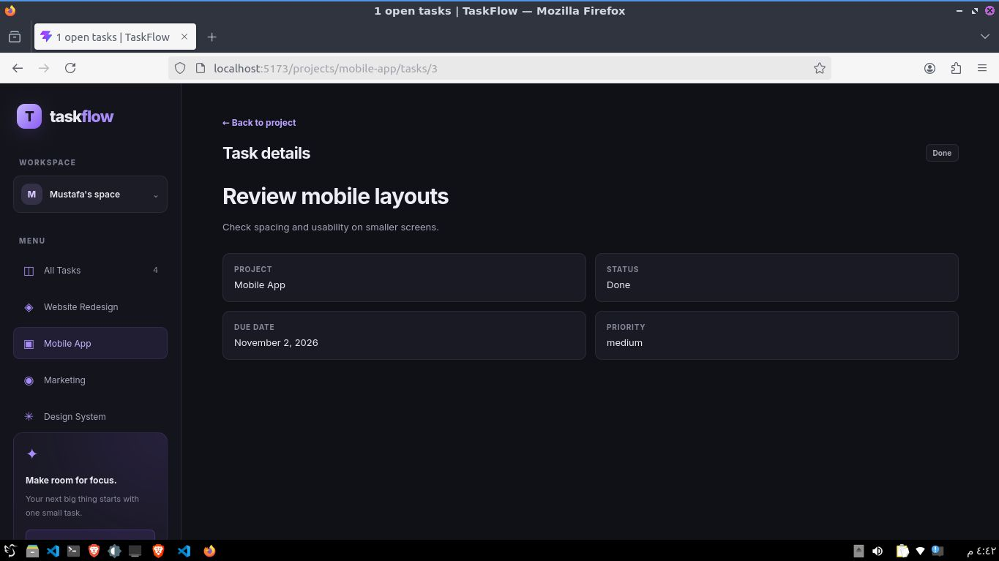
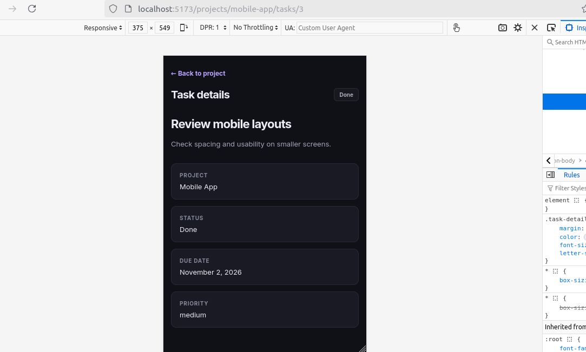

# TaskFlow

TaskFlow is a task management dashboard built with React, TypeScript, and Vite.

This project is part of my JavaScript Everywhere learning journey. Each module introduces new React concepts and improves the application step by step.

## Features

- View and organize tasks by project.
- Add, edit, delete, and duplicate tasks.
- Undo the last deleted task.
- Change task status.
- Filter tasks by project and status.
- Search and sort tasks.
- Select the next task.
- Track task progress and statistics.
- Validate task forms.
- Persist filters using Local Storage.
- Focus search using the `/` keyboard shortcut.
- Debounced search with a 300ms delay.
- Display task counts by status.
- Navigate to task detail pages.
- Display project task counts and progress.
- Sync search and status filters with URL parameters.

## Technologies

- React
- TypeScript
- React Router
- Vite
- CSS
- Browser Local Storage

## Getting Started

Clone the repository:

    git clone https://github.com/Moustafa-Elbaloty/javascript-everywhere.git

Navigate to the project:

    cd javascript-everywhere/react-revision/taskflow

Install dependencies:

    npm install

Start the development server:

    npm run dev

Create a production build:

    npm run build

## Learning Progress

### Module 01 — React Fundamentals

- Set up the React development environment.
- Built the initial TaskFlow interface.
- Practiced components and responsive layouts.

### Module 02 — Components & TypeScript

- Added TypeScript types and interfaces.
- Created reusable components with typed props.
- Practiced optional props and ReactNode.
- Built reusable Badge, Sidebar, and Section components.

### Module 03 — State & Events

- Managed tasks using React state.
- Added task status updates and progress calculations.
- Implemented delete and undo functionality.
- Added sorting and task selection.
- Practiced immutable state updates.

### Module 04 — Forms & Task Management

- Built reusable forms for adding and editing tasks.
- Added form validation.
- Implemented search, filtering, and sorting.
- Added task duplication.
- Improved responsive layouts.

### Module 05 — Custom Hooks & Reusable Logic

- Created useDocumentTitle.
- Created generic useLocalStorage.
- Added the `/` keyboard shortcut using useRef and useEffect.
- Implemented event listener cleanup.
- Created the generic countBy utility.
- Created the generic useDebouncedValue hook.
- Added 300ms debounced search.
- Practiced StrictMode, lazy state initialization, and memoization.

### Module 06 — Routing & Architecture

- Added React Router and task detail pages.
- Created routes using project and task IDs.
- Added task details with a Back to project link.
- Displayed EmptyState for unknown task IDs.
- Added project task counts and completion progress.
- Added the Design System project.
- Documented the project structure in ARCHITECTURE.md.
- Created REFLECTION.md.
- Used useSearchParams to sync search and status filters with the URL.

## Project Architecture

- `src/components/` — Reusable UI components and pages.
- `src/data/` — Static project data.
- `src/hooks/` — Custom React hooks.
- `src/types/` — Shared TypeScript types.
- `src/utils/` — Reusable helper functions.
- `src/assets/` — Static assets.
- `src/App.tsx` — Main application component.
- `src/main.tsx` — Application entry point and BrowserRouter setup.

See ARCHITECTURE.md for more details.

## Screenshots

### Responsive Layouts

### Module 02

### Module 03

### Module 04

### Module 05

### Module 06

