# TaskFlow

TaskFlow is a task management dashboard built with React, TypeScript, and Vite.

This project is part of my JavaScript Everywhere learning journey. Each module adds new React concepts and features while improving the existing application.

## Features

- View and organize tasks by project.
- Add, edit, delete, and duplicate tasks.
- Undo the last deleted task.
- Change task status: Todo, In Progress, and Done.
- Filter tasks by project and status.
- Search tasks by title.
- Sort tasks by title or due date.
- Select the next task.
- Track progress and completion statistics.
- Validate task forms.
- Remember search and status filters using Local Storage.
- Focus the search field using the `/` keyboard shortcut.
- Debounced search with a 300ms delay.
- Display task counts grouped by status.
- Update the browser tab title based on open tasks.

## Technologies

- React
- TypeScript
- Vite
- CSS
- Browser Local Storage

## Getting Started

Clone the repository:

```bash
git clone https://github.com/Moustafa-Elbaloty/javascript-everywhere.git
cd javascript-everywhere/react-revision/taskflow
npm install
npm run dev
npm run build
cat > README.md <<'EOF'
# TaskFlow

A task management dashboard built with React, TypeScript, and Vite.

This project is part of my JavaScript Everywhere learning journey.

## Features

- View and organize tasks by project.
- Add, edit, delete, and duplicate tasks.
- Undo task deletion.
- Change task status.
- Filter tasks by project and status.
- Search and sort tasks.
- Select the next task.
- Track task progress and statistics.
- Validate task forms.
- Persist search and status filters using Local Storage.
- Focus search using the `/` keyboard shortcut.
- Debounced search with a 300ms delay.
- Count tasks by status.
- Update the browser tab title based on open tasks.

## Technologies

- React
- TypeScript
- Vite
- CSS
- Local Storage

## Getting Started

Clone the repository:

    git clone https://github.com/Moustafa-Elbaloty/javascript-everywhere.git

Navigate to the project:

    cd javascript-everywhere/react-revision/taskflow

Install dependencies:

    npm install

Start the development server:

    npm run dev

## Production Build

    npm run build

## Learning Progress

### Module 01 — React Fundamentals
- Set up the React environment.
- Built the initial TaskFlow interface.
- Practiced components and responsive layouts.

### Module 02 — Components & TypeScript
- Added TypeScript types and interfaces.
- Created reusable components with typed props.
- Practiced ReactNode and optional props.

### Module 03 — State & Events
- Managed tasks with React state.
- Added status updates and progress calculations.
- Implemented delete and undo functionality.
- Added sorting and task selection.

### Module 04 — Forms & Task Management
- Built reusable forms for adding and editing tasks.
- Added form validation.
- Implemented search, filtering, and sorting.
- Added task duplication.

### Module 05 — Custom Hooks & Reusable Logic
- Created useDocumentTitle.
- Created generic useLocalStorage.
- Added the `/` keyboard shortcut using useRef and useEffect.
- Implemented event listener cleanup.
- Created the generic countBy utility.
- Created the generic useDebouncedValue hook.
- Added 300ms debounced search.
- Reflected on StrictMode, lazy state initialization, and useMemo.

## Screenshots

### Responsive Layouts

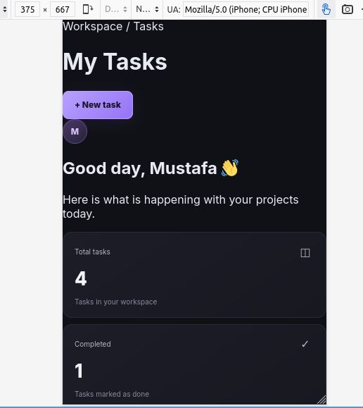

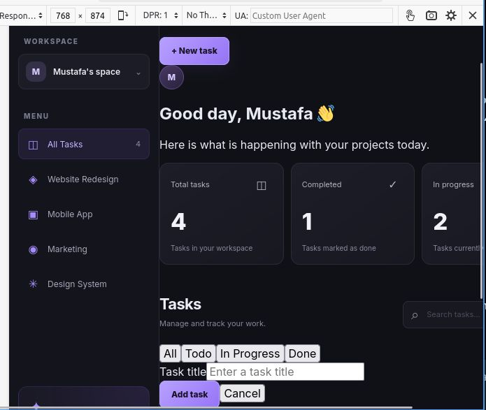

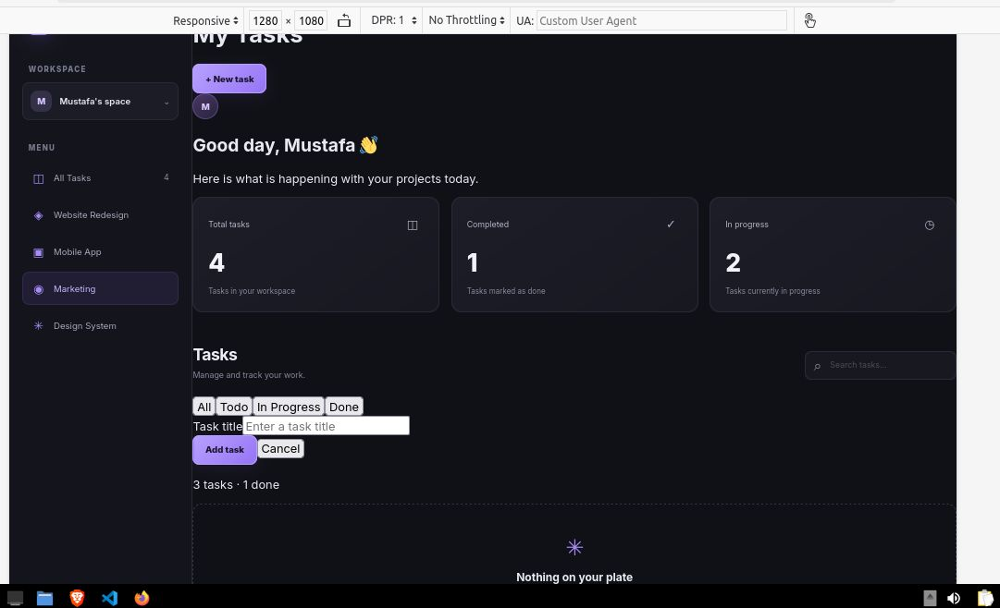

### Module 02

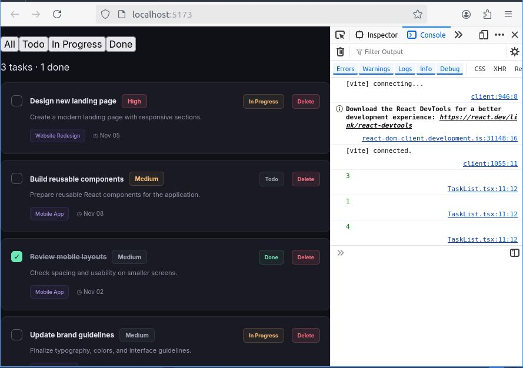

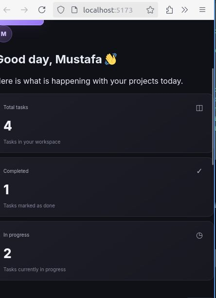

### Module 03

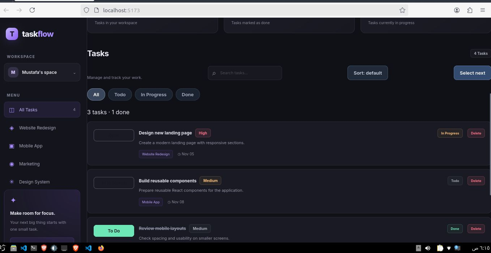

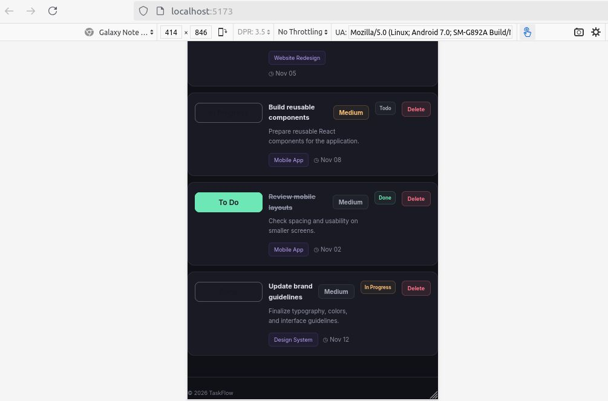

### Module 04

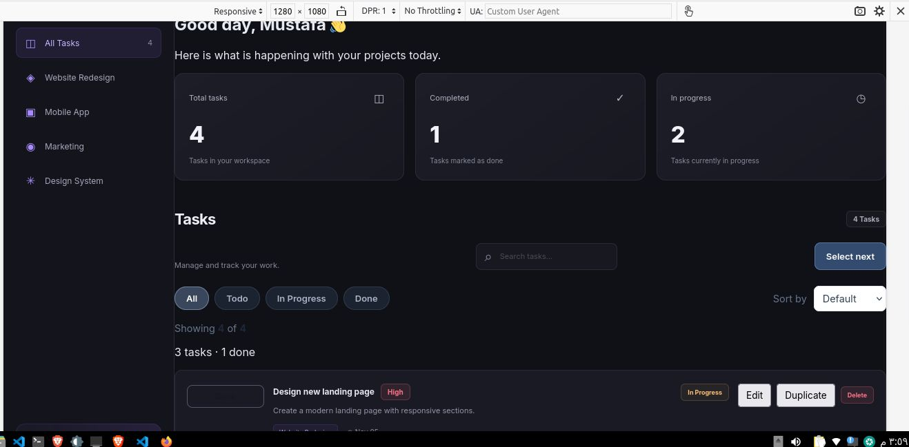

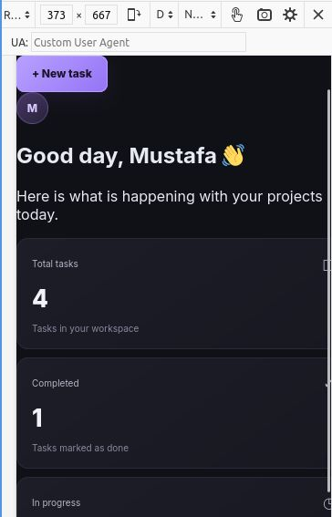

### Module 05 — Custom Hooks & Reusable Logic

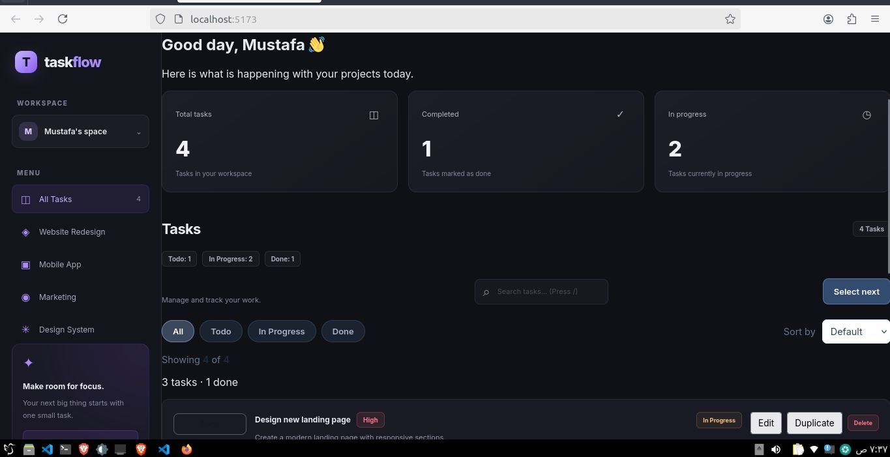

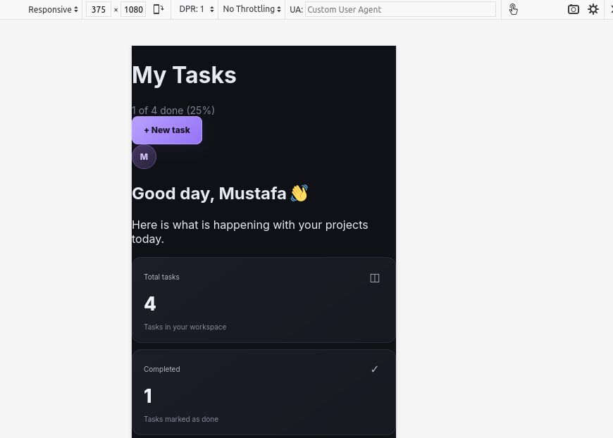
